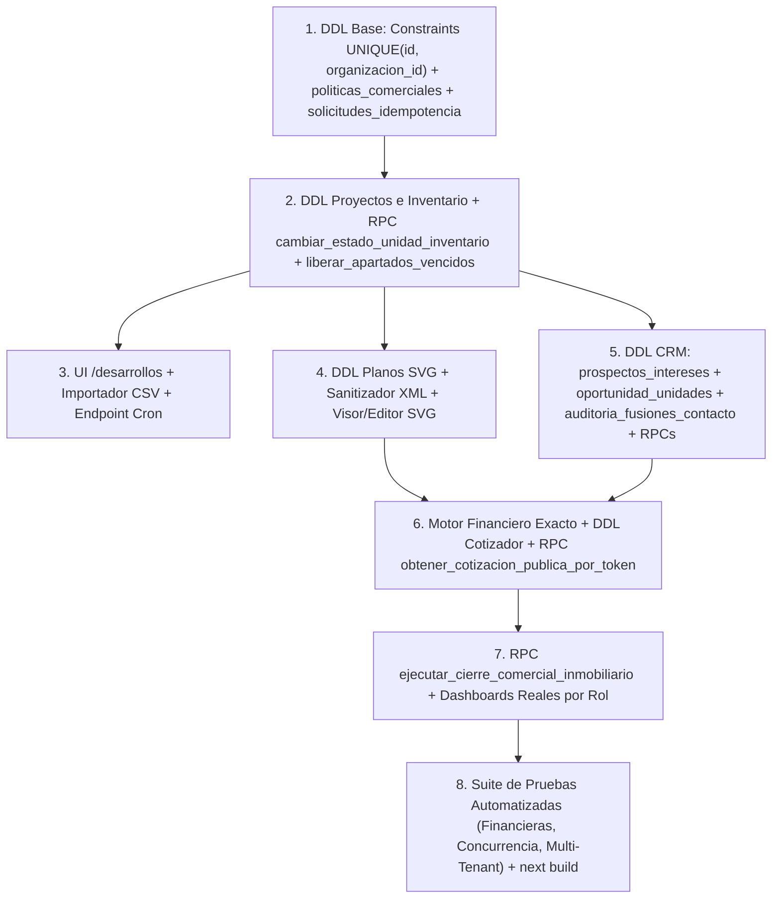

# IRIS — PLANO DE IMPLEMENTACIÓN DE INGENIERÍA (`IRIS_IMPLEMENTATION_BLUEPRINT.md`)

> **Propósito:** Guía de implementación paso a paso para desarrolladores. Especifica tablas, columnas, restricciones, índices, funciones RPC, triggers, políticas RLS, archivos de código afectados y secuencia de construcción sin ambigüedades.

---

## 1. Arquitectura de Datos y Módulos a Construir

### 1.1 Modificaciones Aditivas sobre Tablas Existentes (`000001`–`000010`)

Para habilitar las llaves foráneas compuestas Cross-Tenant sin alterar ni borrar datos actuales:

| Tabla Existente | Modificación DDL Exacta | Propósito |
| :--- | :--- | :--- |
| `public.prospectos` | • `ADD CONSTRAINT uq_prospectos_id_org UNIQUE (id, organizacion_id)` • `ADD COLUMN IF NOT EXISTS telefono_e164 VARCHAR(20) NULL` • `ADD COLUMN IF NOT EXISTS desarrollo_id UUID NULL` • `ADD COLUMN IF NOT EXISTS unidad_id UUID NULL` • `ADD COLUMN IF NOT EXISTS campana_origen VARCHAR(150) NULL` • `ADD COLUMN IF NOT EXISTS fecha_ultima_interaccion TIMESTAMPTZ NULL` • `ADD COLUMN IF NOT EXISTS fecha_proxima_actividad TIMESTAMPTZ NULL` • `ADD COLUMN IF NOT EXISTS posible_duplicado BOOLEAN NOT NULL DEFAULT false` | Soportar FKs compuestas desde `prospectos_intereses` y `cotizaciones_inmobiliarias`, búsqueda E.164, caché del interés principal y alertas de seguimiento. |
| `public.contactos` | • `ADD CONSTRAINT uq_contactos_id_org UNIQUE (id, organizacion_id)` • `ADD COLUMN IF NOT EXISTS telefono_e164 VARCHAR(20) NULL` • `ADD COLUMN IF NOT EXISTS fusionado_en_contacto_id UUID NULL` • `ADD COLUMN IF NOT EXISTS fecha_fusion TIMESTAMPTZ NULL` • `CREATE UNIQUE INDEX idx_contactos_prospecto_origen_unico ON public.contactos(organizacion_id, prospecto_origen_id) WHERE prospecto_origen_id IS NOT NULL AND estado <> 'archivado'` | Garantizar que un mismo prospecto no genere dos contactos por conversión concurrente y soportar trazabilidad de fusiones. |
| `public.oportunidades` | • `ADD CONSTRAINT uq_oportunidades_id_org UNIQUE (id, organizacion_id)` • `ADD COLUMN IF NOT EXISTS codigo_operacion VARCHAR(40) NULL` • `ADD COLUMN IF NOT EXISTS prospecto_origen_id UUID NULL` • `ADD COLUMN IF NOT EXISTS desarrollo_id UUID NULL` • `ADD COLUMN IF NOT EXISTS unidad_principal_id UUID NULL` • `ADD COLUMN IF NOT EXISTS cotizacion_vigente_id UUID NULL` | Convertir a `oportunidades` en el expediente de operación comercial con soporte para 0, 1 o $N$ unidades mediante `oportunidad_unidades`. |
| `public.canales_contacto` | • `ADD COLUMN IF NOT EXISTS contacto_origen_fusion_id UUID NULL` • `ADD COLUMN IF NOT EXISTS archivado_por_fusion_id UUID NULL` • `CREATE UNIQUE INDEX IF NOT EXISTS idx_canales_contacto_unico ON public.canales_contacto(organizacion_id, contacto_id, tipo_canal, LOWER(TRIM(valor))) WHERE archivado_por_fusion_id IS NULL` | Evitar canales duplicados durante la fusión autorizada de contactos y conservar los canales colisionados archivados para permitir una reversión no destructiva. |
| **22 Tablas Existentes (`000001`–`000010`) con Columnas de Usuario** | • **Transición en 3 Pasos hacia `public.membresias(organizacion_id, usuario_id)`:**   1. *Backfill:* Insertar en `public.membresias` cualquier par histórico `(organizacion_id, usuario_id)` existente en tablas operativas que aún no tenga fila de membresía.   2. *Constraint `NOT VALID`:* `ALTER TABLE ... ADD CONSTRAINT fk_..._miembro FOREIGN KEY (organizacion_id, <col_usuario>) REFERENCES public.membresias(organizacion_id, usuario_id) ... NOT VALID;`   3. *Validación:* `ALTER TABLE ... VALIDATE CONSTRAINT fk_..._miembro;` | Migrar relaciones históricas sin fallar por semillas huérfanas previas (como `000009` líneas 164–165) y sin bloquear las tablas en producción. |

---

### 1.2 Nuevas Tablas por Módulo (Definidas en `IRIS_SQL_DESIGN_PROPOSAL.sql`)

#### Módulo 1: Gobernanza, Idempotencia y Políticas Comerciales
1. **`public.solicitudes_idempotencia`**:
   - Registro transaccional de comandos con **`UNIQUE (organizacion_id, operacion, clave_idempotencia)`**, `hash_parametros` (SHA-256 canónico con `pg_catalog.sha256`), `estado` (`'en_proceso'`, `'completada'`, `'fallida'`), `respuesta_json` y `expira_en`.
2. **`public.politicas_comerciales`**, **`public.historial_politicas_comerciales`** y **`public.obtener_politica_comercial_efectiva(UUID, UUID)`**:
   - Parámetros comerciales tipados con índices únicos parciales (`WHERE desarrollo_id IS NULL` para la política global de la organización y `WHERE desarrollo_id IS NOT NULL` para sobreescrituras por desarrollo).
   - En filas de desarrollo (`desarrollo_id IS NOT NULL`), los campos individuales son anulables para permitir **herencia granular campo por campo** con precedencia `COALESCE(p_desarrollo.<campo>, p_organizacion.<campo>, <valor_sistema_default>)`.

#### Módulo 2: Gestión de Proyectos e Inventario Inmobiliario
3. **`public.desarrolladoras`**: Razones sociales o marcas promotoras dentro de la organización.
4. **`public.desarrollos`**: Proyectos inmobiliarios vinculados a `(desarrolladora_id, organizacion_id)`.
5. **`public.etapas_desarrollo`**: Etapas o fases comerciales vinculadas a `(desarrollo_id, organizacion_id)` con `UNIQUE (id, desarrollo_id, organizacion_id)`.
6. **`public.manzanas_desarrollo`**: Manzanas, clusters o niveles vinculados a `(etapa_id, desarrollo_id, organizacion_id)`.
7. **`public.unidades_inmobiliarias`**: Inventario maestro con `UNIQUE (desarrollo_id, clave_comercial)`, `UNIQUE (id, desarrollo_id, organizacion_id)`, `estado_disponibilidad` (`'disponible'`, `'apartado'`, `'vendido'`, `'bloqueado'`), `apartado_vence_en`, `version_registro` (control de concurrencia) y FKs compuestas hacia `membresias` y `prospectos`.
8. **`public.historial_disponibilidad_unidad`**: Bitácora inmutable de cambios de disponibilidad con soporte dual para actor humano (`usuario_id` vía `membresias`) y actor automático (`actor_tipo = 'sistema_cron'`).
9. **`public.documentos_desarrollo`**, **`public.solicitudes_documento`** y **`public.asignaciones_asesor_desarrollo`**.

#### Módulo 3: Planos Interactivos SVG
10. **`public.planos_interactivos`**: Almacenamiento versionado de planos SVG sanitizados por desarrollo/etapa/manzana.
11. **`public.vinculos_plano_unidad`**: Mapeo `svg_element_id ↔ unidad_id` con `UNIQUE (plano_id, svg_element_id)`.

#### Módulo 4: Evolución CRM, Intereses Múltiples y Fusión de Contactos
12. **`public.prospectos_intereses`**: Historial de desarrollos y unidades de interés de cada prospecto con índice único parcial `WHERE es_principal = true AND estado_interes <> 'descartado'` y nulificación selectiva `ON DELETE SET NULL (unidad_id)`.
13. **`public.oportunidad_unidades`**: Relación N:M entre una `Oportunidad` y las $1 \dots N$ unidades involucradas en esa negociación.
14. **`public.coincidencias_duplicados_crm`**: Bandeja de posibles duplicados detectados por teléfono E.164 o correo para revisión humana.
15. **`public.auditoria_fusiones_contacto`**: Bitácora reversible con snapshots JSONB y el mapa exacto de UUIDs reasignados en las 7 tablas hijas.

#### Módulo 5: Cotizador Inmobiliario (Interno y Público)
16. **`public.esquemas_financiamiento`**: Configuración financiera por desarrollo (`tipo_tasa_interes`, `tasa_interes_anual`, `modo_pagos_extraordinarios`, `porcentaje_enganche_min`, `plazos_meses`, `descuento_maximo_pct`).
17. **`public.cotizaciones_inmobiliarias`**: Cotizaciones con `folio`, `token_publico_hash` (SHA-256 de 64 chars), `acceso_publico_activo`, `fecha_vigencia`, `requiere_autorizacion` y `snapshot_comercial` (`JSONB` inmutable).
18. **`public.cotizacion_unidades`**: Detalle de unidades cotizadas con precios y superficies congelados al momento de emisión.

---

## 2. Mapa de Archivos del Repositorio a Crear o Modificar (Por Fase)

> **Nota:** Ninguno de estos archivos de código debe crearse ni modificarse hasta recibir autorización explícita para iniciar la Fase 2.

| Fase | Archivos Nuevos a Crear | Archivos Existentes a Modificar (Aditivamente) |
| :--- | :--- | :--- |
| **FASE 2** *(Proyectos e Inventario)* | • `supabase/migrations/20261124000011_proyectos_inventario_politicass.sql` • `src/tipos/proyectos.ts` • `src/librerias/validaciones/proyectos.ts` • `src/servicios/proyectos.ts` • `src/acciones/proyectos.ts` • `src/componentes/proyectos/vista-proyectos.tsx` • `src/componentes/proyectos/modal-importar-inventario.tsx` • `src/app/(panel)/desarrollos/page.tsx` • `src/app/api/cron/liberar-apartados/route.ts` | • [src/componentes/estructura/armazo-panel.tsx](file:///c:/Users/thegr/OneDrive/Documentos/GitHub/IRIS/src/componentes/estructura/armazo-panel.tsx) *(Agregar ruta `/desarrollos`)* • [src/servicios/asesores.ts](file:///c:/Users/thegr/OneDrive/Documentos/GitHub/IRIS/src/servicios/asesores.ts) *(Corregir nombres de columna `agente_asignado_actual_id` en línea 494 y `agente_asignado_id` en línea 507)* |
| **FASE 3** *(Planos SVG)* | • `supabase/migrations/20261124000012_planos_interactivos_svg.sql` • `src/librerias/utilidades/sanitizador-svg.ts` • `src/servicios/planos-svg.ts` • `src/acciones/planos-svg.ts` • `src/componentes/proyectos/visor-plano-svg.tsx` • `src/componentes/proyectos/editor-plano-svg.tsx` | • `src/componentes/proyectos/vista-proyectos.tsx` *(Integrar pestañas de Visor y Editor SVG por desarrollo)* |
| **FASE 4** *(CRM, Intereses y Fusiones)* | • `supabase/migrations/20261124000013_crm_intereses_fusiones_cotizador.sql` • `src/librerias/utilidades/telefono-e164.ts` • `src/componentes/crm/modal-fusion-contactos.tsx` • `src/componentes/crm/panel-intereses-prospecto.tsx` | • [src/servicios/crm.ts](file:///c:/Users/thegr/OneDrive/Documentos/GitHub/IRIS/src/servicios/crm.ts) • [src/acciones/crm.ts](file:///c:/Users/thegr/OneDrive/Documentos/GitHub/IRIS/src/acciones/crm.ts) • [src/componentes/crm/vista-prospectos.tsx](file:///c:/Users/thegr/OneDrive/Documentos/GitHub/IRIS/src/componentes/crm/vista-prospectos.tsx) • [src/componentes/leads/vista-seguimiento-kanban.tsx](file:///c:/Users/thegr/OneDrive/Documentos/GitHub/IRIS/src/componentes/leads/vista-seguimiento-kanban.tsx) • [src/componentes/crm/vista-contactos.tsx](file:///c:/Users/thegr/OneDrive/Documentos/GitHub/IRIS/src/componentes/crm/vista-contactos.tsx) |
| **FASE 5** *(Motor Financiero y Cotizador)* | • `src/tipos/cotizador.ts` • `src/librerias/financiero/motor-amortizacion.ts` • `src/servicios/cotizador.ts` • `src/acciones/cotizador.ts` • `src/componentes/cotizador/vista-cotizador.tsx` • `src/componentes/cotizador/documento-pdf-cotizacion.tsx` • `src/app/(panel)/cotizador/page.tsx` • `src/app/cotizar/[token]/page.tsx` | • [src/componentes/estructura/armazo-panel.tsx](file:///c:/Users/thegr/OneDrive/Documentos/GitHub/IRIS/src/componentes/estructura/armazo-panel.tsx) *(Agregar ruta `/cotizador`)* |
| **FASE 6** *(Cierre Transaccional y Dashboards)* | • `src/componentes/crm/modal-cierre-comercial.tsx` | • [src/componentes/crm/vista-oportunidades.tsx](file:///c:/Users/thegr/OneDrive/Documentos/GitHub/IRIS/src/componentes/crm/vista-oportunidades.tsx) • [src/servicios/analitica.ts](file:///c:/Users/thegr/OneDrive/Documentos/GitHub/IRIS/src/servicios/analitica.ts) • [src/componentes/crm/vista-panel-operativo.tsx](file:///c:/Users/thegr/OneDrive/Documentos/GitHub/IRIS/src/componentes/crm/vista-panel-operativo.tsx) • [src/componentes/analitica/vista-analitica.tsx](file:///c:/Users/thegr/OneDrive/Documentos/GitHub/IRIS/src/componentes/analitica/vista-analitica.tsx) |

---

## 3. Secuencia Estricta de Implementación y Dependencias

